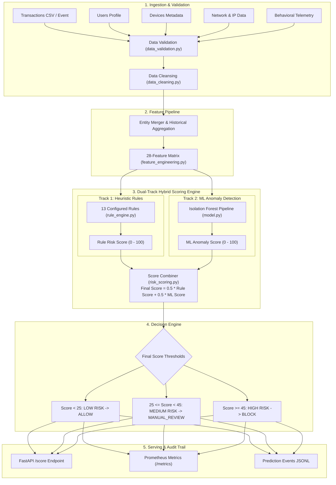

# Hybrid Fraud Detection System (Isolation Forest & Rule Engine)

[](https://www.python.org/downloads/release/python-3110/)
[](https://fastapi.tiangolo.com)
[](https://scikit-learn.org/)
[](https://www.docker.com/)
[](LICENSE)

A production-grade, two-tier risk scoring and fraud prevention platform for digital wallets, gaming transactions, and financial ecosystems. The system combines **13 deterministic business rules** for known heuristic patterns with **unsupervised Isolation Forest anomaly detection** for identifying zero-day and stealth fraud rings.

---

## Table of Contents
- [1. System Architecture](#1-system-architecture)
- [2. Dual-Track Scoring Mechanism](#2-dual-track-scoring-mechanism)
- [3. Feature Engineering (28 Features)](#3-feature-engineering-28-features)
- [4. The 13 Deterministic Fraud Rules](#4-the-13-deterministic-fraud-rules)
- [5. Machine Learning Anomaly Detection Engine](#5-machine-learning-anomaly-detection-engine)
- [6. Decision Matrix & SLAs](#6-decision-matrix--slas)
- [7. API Reference](#7-api-reference)
- [8. Project Directory Structure](#8-project-directory-structure)
- [9. Setup & Quickstart](#9-setup--quickstart)
- [10. Testing](#10-testing)
- [11. Docker Deployment](#11-docker-deployment)

---

## 1. System Architecture



---

## 2. Dual-Track Scoring Mechanism

The system evaluates incoming transactions using two parallel evaluation tracks:

1. **Deterministic Rule Score ($0 - 100$):**
   $$\text{Raw Score} = \sum_{r \in \text{Fired Rules}} \text{Weight}_r$$
   $$\text{Rule Score} = 100.0 \times \frac{\text{Raw Score}}{\sum \text{All Weights}} = \frac{100.0 \times \text{Raw Score}}{230}$$
2. **ML Anomaly Score ($0 - 100$):**
   Evaluates multi-dimensional feature deviance via inverted and normalized tree path isolation:
   $$S_{\text{raw}} = -\text{score\_samples}(X)$$
   $$\text{ML Anomaly Score} = 100.0 \times \frac{S_{\text{raw}} - \min(S_{\text{raw}})}{\max(S_{\text{raw}}) - \min(S_{\text{raw}})}$$
3. **Composite Final Fraud Score:**
   $$\text{Final Fraud Score} = (0.5 \times \text{Rule Score}) + (0.5 \times \text{ML Anomaly Score})$$

---

## 3. Feature Engineering (28 Features)

The feature matrix merges transaction, user, device, network, behavioral, and rolling historical aggregations:

| # | Feature | Definition & Formula | Fraud Vector Addressed |
| :---: | :--- | :--- | :--- |
| **1** | `amount_log` | $\ln(1 + \text{txn\_amount})$ | Reduces skewness in transaction amounts |
| **2** | `account_age_days` | Age of user account in days | Account tenure baseline |
| **3** | `is_new_account` | $\text{account\_age\_days} < 7$ (Binary) | Promotional / welcome-bonus abuse |
| **4** | `is_android` | $\text{os\_type} == \text{'android'}$ (Binary) | Elevated emulator / sideload risk |
| **5** | `referral_count` | Total successful referrals by user | Referral farming detection |
| **6** | `referral_depth` | Hierarchical invitation depth | Pyramid / multi-tier fraud networks |
| **7** | `session_duration_min` | $\text{session\_duration} / 60.0$ | Automated script / micro-session detection |
| **8** | `click_rate` | $\text{click\_count} / \max(1, \text{session\_duration})$ | Super-human click frequency (auto-clickers) |
| **9** | `click_entropy` | Shannon entropy of tap distributions | Invariant / robotic screen clicks |
| **10** | `behavior_score` | Ingested behavior score ($0 - 100$) | Upstream device intelligence signal |
| **11** | `txn_count_1h` | Rolling 1-hour transaction frequency | Rapid velocity bursting |
| **12** | `txn_count_24h` | Rolling 24-hour transaction frequency | Daily threshold violations |
| **13** | `velocity_ratio` | $\text{txn\_count\_1h} / (\text{txn\_count\_24h} + 1)$ | Spike relative to daily baseline |
| **14** | `high_velocity_1h` | $\text{txn\_count\_1h} > 5$ (Binary) | Immediate velocity tripwire |
| **15** | `failure_rate_24h` | Failed transactions / Total 24h transactions | Card testing / brute-force attempts |
| **16** | `wallet_change_log` | $\text{sign}(\Delta) \cdot \ln(1 + \|\Delta\|)$ over 24h | Rapid wallet draining / liquidation |
| **17** | `amount_deviation_ratio` | $\text{txn\_amount} / (\text{avg\_txn\_amount\_7d} + 1)$ | Transaction size vs. historical habit |
| **18** | `deviation_flag` | $\text{amount\_deviation\_ratio} > 3.0$ (Binary) | Outlier transaction size alert |
| **19** | `device_risk_score` | $\text{emulator} + \text{rooted} + \mathbb{I}(\text{dev\_accounts} > 3)$ | Composite hardware risk ($0 - 3$) |
| **20** | `network_risk_score` | $\text{vpn} + \text{proxy} + \text{geo\_mismatch} + \mathbb{I}(\text{ip\_accounts} > 5)$ | Composite routing risk ($0 - 4$) |
| **21** | `emulator_flag` | Device is virtualized/emulator ($0/1$) | Device farm automation |
| **22** | `rooted_flag` | Device is rooted/jailbroken ($0/1$) | App memory tampering |
| **23** | `accounts_per_device` | Users registered to single device ID | Multi-accounting detection |
| **24** | `vpn_flag` | Commercial VPN IP detected ($0/1$) | Identity & origin concealment |
| **25** | `proxy_flag` | Proxy connection detected ($0/1$) | Network obfuscation |
| **26** | `geo_mismatch_flag` | Signup country $\neq$ IP country ($0/1$) | Account takeover (ATO) |
| **27** | `accounts_per_ip` | Distinct accounts seen on same IP | Network cluster farm abuse |
| **28** | `unverified_kyc` | KYC status is unverified ($0/1$) | Identity verification gap |

---

## 4. The 13 Deterministic Fraud Rules

Configured in `configs/config.yaml`:

| Rule Name | Evaluation Condition | Config Key | Weight |
| :--- | :--- | :--- | :---: |
| `emulator_flag` | Device reported as emulator | `rules.emulator_flag` | **30** |
| `vpn_flag` | User routing through commercial VPN | `rules.vpn_flag` | **25** |
| `high_velocity_1h` | Hourly transaction count $> 5$ | `thresholds.high_velocity_1h: 5` | **25** |
| `proxy_flag` | Datacenter or residential proxy | `rules.proxy_flag` | **20** |
| `geo_mismatch` | Signup country $\neq$ Current IP country | `rules.geo_mismatch` | **20** |
| `high_deviation` | Spend $> 3.0\times$ 7-day average spend | `thresholds.amount_deviation_multiplier: 3.0` | **20** |
| `device_sharing` | Accounts linked to device $> 3$ | `thresholds.accounts_per_device: 3` | **20** |
| `rooted_flag` | OS root / jailbreak flag detected | `rules.rooted_flag` | **15** |
| `high_velocity_24h` | Daily transaction count $> 20$ | `thresholds.high_velocity_24h: 20` | **15** |
| `ip_sharing` | Accounts linked to IP $> 5$ | `thresholds.accounts_per_ip: 5` | **15** |
| `high_failure_rate` | 24-hour failure rate $> 50\%$ | `thresholds.high_failure_rate: 0.50` | **15** |
| `unverified_kyc` | User KYC status is not verified | `rules.unverified_kyc` | **10** |
| `new_account` | Account age $< 7$ days | `thresholds.new_account_days: 7` | **10** |
| **Total Weight Pool** | $\sum \text{Weights}$ | — | **230** |

---

## 5. Machine Learning Anomaly Detection Engine

Built with `scikit-learn`:

```python
Pipeline(steps=[
    ('imputer', SimpleImputer(strategy='median')),
    ('scaler', StandardScaler()),
    ('model', IsolationForest(
        n_estimators=200,
        contamination=0.06,
        max_samples=256,
        max_features=1.0,
        random_state=42,
        n_jobs=-1
    ))
])
```

- **Missing Value Handling:** Median imputation prevents feature leakage while retaining robustness against missing telemetry.
- **Normalization:** Standard scaling guarantees consistent numerical ranges.
- **Explainability:** Anomaly score is returned alongside rule details for auditability.

---

## 6. Decision Matrix & SLAs

| Final Score Range | Risk Level | Action Decision | SLA Policy |
| :---: | :---: | :---: | :--- |
| **$0 \le \text{Score} < 25$** | **`LOW`** | **`ALLOW`** | Real-time approval ($< 50\text{ ms}$). Zero customer friction. |
| **$25 \le \text{Score} < 45$** | **`MEDIUM`** | **`MANUAL_REVIEW`** | Held in escrow; queued to analyst dashboard with triggered rules. |
| **$\text{Score} \ge 45$** | **`HIGH`** | **`BLOCK`** | Immediate rejection; alerts logged and metrics incremented. |

---

## 7. API Reference

### Real-Time Scoring: `POST /score`

**Request Payload:**
```json
{
  "txn_id": "TXN_109283",
  "user_id": "USR_99214",
  "txn_amount": 2500.0,
  "txn_type": "transfer",
  "txn_timestamp": "2026-09-24T12:00:00Z",
  "txn_status": "success",
  "account_age_days": 2,
  "kyc_status": "unverified",
  "signup_country": "IN",
  "signup_city": "Bengaluru",
  "referral_count": 8,
  "referral_depth": 2,
  "device_id": "DEV_00492",
  "os_type": "android",
  "app_version": "1.2.0",
  "emulator_flag": 1,
  "rooted_flag": 0,
  "accounts_per_device": 5,
  "ip_address": "185.220.101.5",
  "ip_country": "DE",
  "ip_city": "Frankfurt",
  "vpn_flag": 1,
  "proxy_flag": 0,
  "geo_mismatch_flag": 1,
  "accounts_per_ip": 7,
  "session_duration": 12.0,
  "click_count": 120,
  "time_between_actions": 0.05,
  "screen_flow_length": 2,
  "click_entropy": 0.15,
  "behavior_score": 85.0,
  "txn_count_1h": 7,
  "txn_count_24h": 24,
  "avg_txn_amount_7d": 150.0,
  "failure_rate_24h": 0.35,
  "wallet_balance_change_24h": 4500.0
}
```

**Response Payload (`200 OK`):**
```json
{
  "txn_id": "TXN_109283",
  "user_id": "USR_99214",
  "rule_score": 76.09,
  "ml_anomaly_score": 82.45,
  "final_fraud_score": 79.27,
  "risk_level": "HIGH",
  "decision": "BLOCK",
  "rules_fired": [
    "emulator_flag",
    "vpn_flag",
    "high_velocity_1h",
    "geo_mismatch",
    "high_deviation",
    "device_sharing",
    "high_velocity_24h",
    "ip_sharing",
    "unverified_kyc",
    "new_account"
  ],
  "rule_details": [
    {"rule": "emulator_flag", "weight": 30.0},
    {"rule": "vpn_flag", "weight": 25.0},
    {"rule": "high_velocity_1h", "weight": 25.0},
    {"rule": "geo_mismatch", "weight": 20.0},
    {"rule": "high_deviation", "weight": 20.0},
    {"rule": "device_sharing", "weight": 20.0},
    {"rule": "high_velocity_24h", "weight": 15.0},
    {"rule": "ip_sharing", "weight": 15.0},
    {"rule": "unverified_kyc", "weight": 10.0},
    {"rule": "new_account", "weight": 10.0}
  ],
  "explanation": "BLOCK because final score is 79.27 with rules fired: emulator_flag, vpn_flag, high_velocity_1h, geo_mismatch, high_deviation."
}
```

### Healthcheck: `GET /health`
```json
{
  "status": "ok",
  "model_loaded": true,
  "model_path": "models/fraud_iforest_pipeline.joblib"
}
```

### Prometheus Metrics: `GET /metrics`
Exposes:
- `fraud_score_requests_total`
- `fraud_block_decisions_total`
- `fraud_score_latency_seconds`

---

## 8. Project Directory Structure

```text
IsolationForest/
├── configs/
│   └── config.yaml               # Model parameters, thresholds, and weights
├── data/
│   ├── raw/                      # Raw input CSVs (users, transactions, devices, etc.)
│   └── processed/                # Cleaned datasets, master features, scored data
├── models/
│   └── fraud_iforest_pipeline.joblib  # Serialized scikit-learn pipeline artifact
├── logs/
│   ├── prediction_events.jsonl   # Streaming JSONL prediction log
│   └── training_metrics.json     # Offline validation metrics
├── scripts/
│   ├── generate_sample_data.py   # Synthetic data generation with 6% fraud injection
│   ├── train_model.py            # Model training & evaluation pipeline
│   └── batch_score.py            # Offline batch scoring runner
├── src/fraud_detection/
│   ├── __init__.py
│   ├── api.py                    # FastAPI service with Prometheus integration
│   ├── config.py                 # Configuration loader & validator
│   ├── data_cleaning.py          # Data cleansing and normalization
│   ├── data_validation.py        # Strict input validation schemas
│   ├── feature_engineering.py    # 28-feature transformation engine
│   ├── model.py                  # Isolation Forest model wrapper
│   ├── monitoring.py             # Event logger
│   ├── pipeline.py               # Training and batch orchestration
│   ├── risk_scoring.py           # Composite risk score and decision engine
│   ├── rule_engine.py            # 13 deterministic rule evaluations
│   └── schema.py                 # Pydantic request and response schemas
├── tests/
│   ├── test_api.py               # API health & endpoint tests
│   ├── test_feature_engineering.py  # Feature generation tests
│   └── test_rule_engine.py       # Rule engine validation tests
├── Dockerfile                    # Container definition
├── docker-compose.yml            # Local orchestration
├── pyproject.toml
└── requirements.txt
```

---

## 9. Setup & Quickstart

### 9.1 Environment Setup
```bash
python -m venv .venv
source .venv/bin/activate  # On Windows: .venv\Scripts\activate
pip install -r requirements.txt
pip install -e .
```

### 9.2 Create Demo Data
```bash
python scripts/generate_sample_data.py
```
Generates 1,200 users and 5,000 transactions across 5 CSV files in `data/raw/`.

### 9.3 Train & Evaluate Model
```bash
python scripts/train_model.py --config configs/config.yaml
```
Outputs model artifact to `models/fraud_iforest_pipeline.joblib` and metrics to `logs/training_metrics.json`.

### 9.4 Batch Scoring
```bash
python scripts/batch_score.py --config configs/config.yaml --output data/processed/batch_scored_transactions.csv
```

### 9.5 Start Real-Time API
```bash
uvicorn fraud_detection.api:app --host 0.0.0.0 --port 8000 --reload
```
Swagger UI documentation available at: `http://localhost:8000/docs`

---

## 10. Testing

Run the test suite with pytest:
```bash
pytest -v
```

---

## 11. Docker Deployment

### Build and Run with Docker Compose
```bash
docker compose up --build -d
```

### Check Logs & Status
```bash
docker compose logs -f
curl http://localhost:8000/health
```
